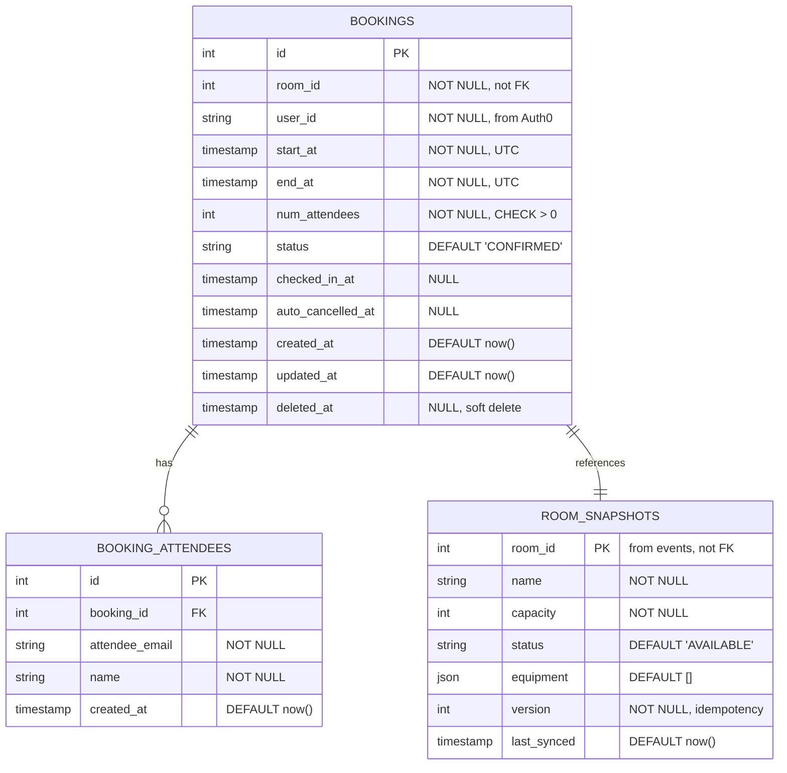
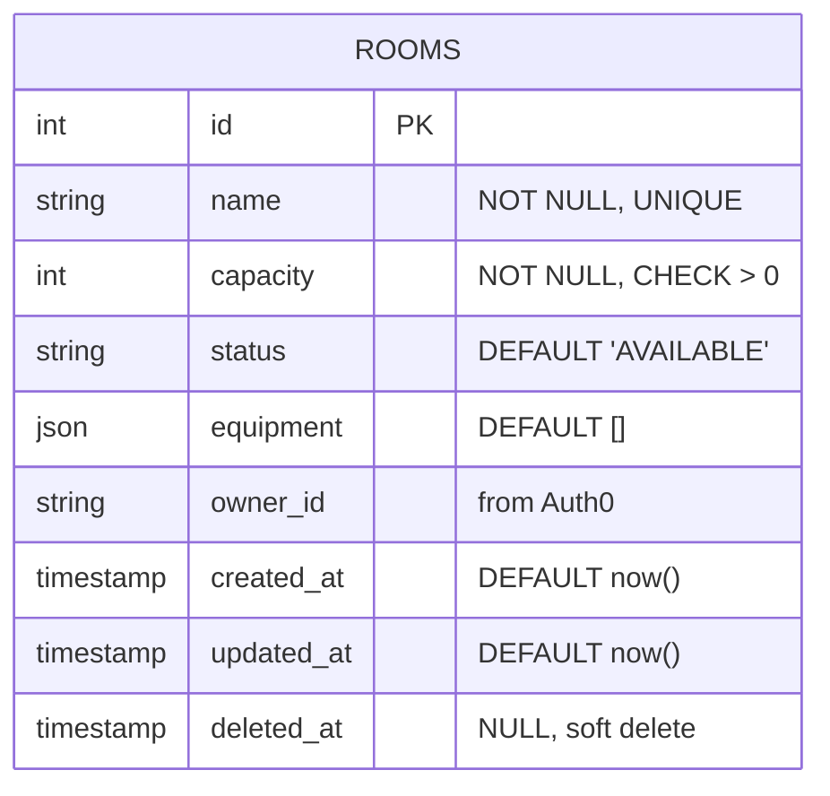

# Entity Relationship Diagram (ERD)

Sơ đồ database cho `booking_db` (Booking Service) và `room_db` (Room Service).

**Lưu ý:** Không có foreign keys giữa 2 database (ADR-0002). Booking sử dụng `room_snapshots` để join với data phòng cục bộ (ADR-0003).

**Cập nhật:** 2026-10-10

---

## 1. Mermaid ER Diagram

### booking_db (Booking Service)



### room_db (Room Service)



---

## 2. Chi Tiết Từng Table

### booking_db.bookings

**Mục đích:** Lưu các booking (đặt phòng)

| Cột | Kiểu | Constraint | Ghi chú |
|---|---|---|---|
| `id` | `SERIAL` | PRIMARY KEY | Auto-increment |
| `room_id` | `INTEGER` | NOT NULL | Tham chiếu room, **KHÔNG FK** (khác database) |
| `user_id` | `VARCHAR(255)` | NOT NULL | Auth0 subject claim (`sub`) |
| `start_at` | `TIMESTAMP WITH TIME ZONE` | NOT NULL | UTC, half-open `[start, end)` |
| `end_at` | `TIMESTAMP WITH TIME ZONE` | NOT NULL | UTC, phải > start_at |
| `num_attendees` | `INTEGER` | NOT NULL, CHECK > 0 | Số người, kiểm tra ≤ capacity |
| `status` | `VARCHAR(20)` | DEFAULT 'CONFIRMED', CHECK IN (...) | CONFIRMED, CHECKED_IN, CANCELLED |
| `checked_in_at` | `TIMESTAMP WITH TIME ZONE` | NULL | Khi user check-in |
| `auto_cancelled_at` | `TIMESTAMP WITH TIME ZONE` | NULL | Khi auto-cancel (15 phút sau start) |
| `created_at` | `TIMESTAMP WITH TIME ZONE` | DEFAULT now() | Audit |
| `updated_at` | `TIMESTAMP WITH TIME ZONE` | DEFAULT now() | Audit |
| `deleted_at` | `TIMESTAMP WITH TIME ZONE` | NULL | Soft delete (tuần 5, audit log) |

**Constraints:**

```sql
-- Half-open interval overlap detection (Assumption #1)
EXCLUDE USING gist (
    room_id WITH =,
    tstzrange(start_at, end_at, '[)') WITH &&
) WHERE (status IN ('CONFIRMED', 'CHECKED_IN'));

-- Reason: prevents double-booking on same room at overlapping times
-- WHERE clause: only check confirmed/checked-in bookings (ignore cancelled)
-- tstzrange(..., '[)') = half-open [start, end)
-- && = overlap operator
```

**Indexes:**

```sql
-- Find overlapping bookings (FR-03: find available rooms)
CREATE INDEX idx_bookings_room_time 
ON bookings(room_id, start_at, end_at) 
WHERE status IN ('CONFIRMED', 'CHECKED_IN');

-- Find user's bookings
CREATE INDEX idx_bookings_user_created 
ON bookings(user_id, created_at DESC);

-- Auto-cancel job: find expired CONFIRMED bookings
CREATE INDEX idx_bookings_auto_cancel 
ON bookings(status, start_at) 
WHERE status = 'CONFIRMED';
-- Partial index: only CONFIRMED rows, saves space + scan time
```

---

### booking_db.booking_attendees

**Mục đích:** Danh sách người tham dự mỗi booking

| Cột | Kiểu | Constraint | Ghi chú |
|---|---|---|---|
| `id` | `SERIAL` | PRIMARY KEY | |
| `booking_id` | `INTEGER` | NOT NULL, FK → bookings.id | Tham chiếu booking |
| `attendee_email` | `VARCHAR(255)` | NOT NULL | Email người tham dự |
| `name` | `VARCHAR(255)` | NOT NULL | Tên người tham dự |
| `created_at` | `TIMESTAMP WITH TIME ZONE` | DEFAULT now() | |

**Constraints:**

```sql
-- Foreign key: tham chiếu booking (cùng database, được phép)
ALTER TABLE booking_attendees
ADD CONSTRAINT fk_booking_attendees_booking_id
FOREIGN KEY (booking_id) REFERENCES bookings(id) ON DELETE CASCADE;

-- Unique: 1 email chỉ tham dự 1 lần trên 1 booking
ALTER TABLE booking_attendees
ADD CONSTRAINT uq_booking_attendee
UNIQUE (booking_id, attendee_email);
```

**Indexes:**

```sql
-- Find all attendees of a booking
CREATE INDEX idx_booking_attendees_booking_id 
ON booking_attendees(booking_id);

-- Find bookings an attendee joins
CREATE INDEX idx_booking_attendees_email 
ON booking_attendees(attendee_email);
```

---

### booking_db.room_snapshots

**Mục đích:** Local copy của phòng (from events), để JOIN với bookings khi query

| Cột | Kiểu | Constraint | Ghi chú |
|---|---|---|---|
| `room_id` | `INTEGER` | PRIMARY KEY | Tham chiếu room từ room_db, **KHÔNG FK** |
| `name` | `VARCHAR(255)` | NOT NULL | Tên phòng (copy) |
| `capacity` | `INTEGER` | NOT NULL, CHECK > 0 | Dung tích (copy) |
| `status` | `VARCHAR(50)` | DEFAULT 'AVAILABLE', CHECK IN (...) | AVAILABLE, MAINTENANCE, ARCHIVED |
| `equipment` | `JSON` | DEFAULT '[]' | Danh sách trang thiết bị: ["projector", "whiteboard", ...] |
| `version` | `INTEGER` | NOT NULL | Event version → idempotency (Assumption ADR-0003) |
| `last_synced` | `TIMESTAMP WITH TIME ZONE` | DEFAULT now() | Khi lần cuối sync từ event |

**Constraints:**

```sql
-- room_id là PK: 1 room = 1 snapshot
-- version tracking: chỉ update nếu event.version > snapshot.version
```

**Indexes:**

```sql
-- Find available rooms (FR-03)
CREATE INDEX idx_room_snapshots_status_capacity 
ON room_snapshots(status, capacity) 
WHERE status = 'AVAILABLE';
```

**Khi nào populate:**
1. **Initial sync** (task #6): Booking Service gọi `GET /api/rooms` từ Room Service → insert tất cả
2. **Event-driven** (tuần 2): Room Service publish `room.created`, `room.updated` → Booking consume → update snapshot

**Trường hợp Room Service down:**
- Query `room_snapshots` vẫn chạy (dùng data cũ)
- Healthcheck trả 503 nếu snapshot > 1 giờ cũ

---

### room_db.rooms

**Mục đích:** Lưu thông tin phòng

| Cột | Kiểu | Constraint | Ghi chú |
|---|---|---|---|
| `id` | `SERIAL` | PRIMARY KEY | |
| `name` | `VARCHAR(255)` | NOT NULL, UNIQUE | Tên phòng (P101, P102, ...) |
| `capacity` | `INTEGER` | NOT NULL, CHECK > 0 | Dung tích (người) |
| `status` | `VARCHAR(50)` | DEFAULT 'AVAILABLE', CHECK IN (...) | AVAILABLE, MAINTENANCE, ARCHIVED |
| `equipment` | `JSON` | DEFAULT '[]' | ["projector", "whiteboard", "video_conference"] |
| `owner_id` | `VARCHAR(255)` | NULL | Auth0 sub của chủ phòng (Room Manager) |
| `created_at` | `TIMESTAMP WITH TIME ZONE` | DEFAULT now() | |
| `updated_at` | `TIMESTAMP WITH TIME ZONE` | DEFAULT now() | |
| `deleted_at` | `TIMESTAMP WITH TIME ZONE` | NULL | Soft delete |

**Constraints:**

```sql
-- name unique: không có 2 phòng cùng tên
ALTER TABLE rooms
ADD CONSTRAINT uq_rooms_name UNIQUE (name) WHERE deleted_at IS NULL;
-- Partial unique: ignore soft-deleted rooms
```

**Indexes:**

```sql
-- Find rooms by status (FR-01: list all available)
CREATE INDEX idx_rooms_status 
ON rooms(status) 
WHERE deleted_at IS NULL;

-- Find rooms by owner (Room Manager views own rooms)
CREATE INDEX idx_rooms_owner_id 
ON rooms(owner_id) 
WHERE deleted_at IS NULL;
```

---

## 3. Relationships & Constraints

### booking_db

```
┌─────────────────────┐
│      BOOKINGS       │
├─────────────────────┤
│ id (PK)             │
│ room_id (not FK)    │ ──┐
│ user_id             │   │
│ start_at            │   │
│ end_at              │   │
│ num_attendees       │   │
│ status              │   │
│ ...                 │   │
└─────────────────────┘   │
        │                 │
        │ (1:N)           │
        │                 │
┌───────┴──────────────┐  │
│ BOOKING_ATTENDEES    │  │
├──────────────────────┤  │
│ id (PK)              │  │
│ booking_id (FK) ──┐  │  │
│ attendee_email   │  │  │
│ name             │  │  │
└──────────────────┘  │  │
                      │  │
┌─────────────────────┴──┴─────────────┐
│      ROOM_SNAPSHOTS                  │
├──────────────────────────────────────┤
│ room_id (PK, not FK to room_db)      │
│ name                                 │
│ capacity                             │
│ status                               │
│ equipment (JSON)                     │
│ version (for idempotency)            │
│ last_synced                          │
└──────────────────────────────────────┘

Note: bookings.room_id KHÔNG FK
      Room data từ room_snapshots (event-driven)
      EXCLUDE constraint trên [start, end) để không overlap
```

### room_db

```
┌──────────────────────┐
│       ROOMS          │
├──────────────────────┤
│ id (PK)              │
│ name (UNIQUE)        │
│ capacity             │
│ status               │
│ equipment (JSON)     │
│ owner_id             │
│ created_at           │
│ updated_at           │
│ deleted_at (soft)    │
└──────────────────────┘

Note: NO FK to booking_db
      Room Service publish events when change
      Booking Service subscribe → update room_snapshots
```

---

## 4. Key Design Decisions

### ❌ KHÔNG có Foreign Keys giữa 2 databases

```sql
-- ❌ KHÔNG SỬ DỤNG
ALTER TABLE bookings
ADD CONSTRAINT fk_bookings_room_id
FOREIGN KEY (room_id) REFERENCES room_db.rooms(id);
-- Lý do: PostgreSQL không cho FK giữa 2 databases khác nhau
-- Solution: event-driven snapshots + application-level checks
```

### ✅ EXCLUDE Constraint: Prevent Double Booking

```sql
-- Ngăn [start, end) overlap với các booking khác trên cùng room
ALTER TABLE bookings
ADD CONSTRAINT no_overlapping_bookings
EXCLUDE USING gist (
    room_id WITH =,
    tstzrange(start_at, end_at, '[)') WITH &&
) WHERE (status IN ('CONFIRMED', 'CHECKED_IN'));

-- Giải thích:
-- • EXCLUDE: constraint loại (như UNIQUE, nhưng cho ranges)
-- • room_id WITH =: 2 row phải có room_id khác nhau hoặc...
-- • tstzrange(...) WITH &&: 2 ranges không được overlap
-- • WHERE: chỉ kiểm tra confirmed/checked-in bookings (ignore cancelled)
-- • '[)': half-open interval [start, end)
```

### ✅ Soft Delete: Không xóa thực, chỉ đánh dấu

```sql
-- Để giữ audit trail (FR-08, tuần 5)
SELECT * FROM bookings WHERE deleted_at IS NULL;

-- Indexes cũng dùng partial để tránh scan deleted rows
CREATE INDEX idx_bookings_user_created 
ON bookings(user_id, created_at DESC) 
WHERE deleted_at IS NULL;
```

### ✅ Partial Indexes: Tối ưu cho specific queries

```sql
-- Auto-cancel job: chỉ CONFIRMED bookings
CREATE INDEX idx_bookings_auto_cancel 
ON bookings(status, start_at) 
WHERE status = 'CONFIRMED';
-- Lợi: nhỏ hơn full index, scan nhanh hơn

-- Available rooms: chỉ AVAILABLE phòng
CREATE INDEX idx_room_snapshots_status 
ON room_snapshots(status, capacity) 
WHERE status = 'AVAILABLE';
```

### ✅ JSON Equipment: Linh hoạt thêm/xóa trang thiết bị

```json
{
  "equipment": ["projector", "whiteboard", "video_conference", "air_conditioner"]
}
```

Không cần tạo table `room_equipment` riêng (normalization overkill cho demo project).

---

## 5. Queries Chính (tham khảo)

### FR-03: Tìm phòng trống

```sql
-- Find available rooms with capacity >= 15, time [09:00, 10:00) not booked
SELECT 
    rs.room_id,
    rs.name,
    rs.capacity,
    rs.equipment
FROM room_snapshots rs
LEFT JOIN bookings b ON (
    rs.room_id = b.room_id
    AND b.start_at < '2026-10-10 10:00:00+00:00'::timestamptz
    AND b.end_at > '2026-10-10 09:00:00+00:00'::timestamptz
    AND b.status IN ('CONFIRMED', 'CHECKED_IN')
)
WHERE 
    rs.status = 'AVAILABLE'
    AND rs.capacity >= 15
    AND b.id IS NULL  -- ← no overlapping booking
ORDER BY rs.capacity;
```

### Find user's bookings

```sql
SELECT 
    id, room_id, start_at, end_at, 
    num_attendees, status, checked_in_at
FROM bookings
WHERE user_id = 'auth0|123456' AND deleted_at IS NULL
ORDER BY start_at DESC;
```

### Auto-cancel expired CONFIRMED bookings

```sql
UPDATE bookings
SET status = 'CANCELLED', auto_cancelled_at = NOW()
WHERE 
    status = 'CONFIRMED'
    AND start_at + interval '15 minutes' <= NOW()
    AND deleted_at IS NULL;
```

---

## 6. Timeline: Cài đặt Schema

| Tuần | Task | Chi tiết |
|---|---|---|
| 1 (tuần này) | Task #5 ✅ | ERD này |
| 1 | Task #6 | Alembic migration: tạo bảng + constraints + indexes |
| 2 | Task #7 | RabbitMQ setup |
| 2 | Task #9 | Room Service skeleton + migration room_db |
| 2 | Task #10 | Room CRUD endpoints |
| 3 | Task #3 | Code FR-03 (find available rooms) |
| 3 | Task #4 | Code FR-04 (create booking) |
| 5 | Task #5+ | Audit log table, soft delete logic |

---

## 7. SQL: Khởi tạo (Alembic migration tuần 1)

```sql
-- Task #6: migration đầu tiên cho booking_db
-- alembic/versions/001_initial_schema.py

CREATE EXTENSION IF NOT EXISTS btree_gist;

CREATE TABLE bookings (
    id SERIAL PRIMARY KEY,
    room_id INTEGER NOT NULL,
    user_id VARCHAR(255) NOT NULL,
    start_at TIMESTAMP WITH TIME ZONE NOT NULL,
    end_at TIMESTAMP WITH TIME ZONE NOT NULL,
    num_attendees INTEGER NOT NULL CHECK (num_attendees > 0),
    status VARCHAR(20) NOT NULL DEFAULT 'CONFIRMED'
        CHECK (status IN ('CONFIRMED', 'CHECKED_IN', 'CANCELLED')),
    checked_in_at TIMESTAMP WITH TIME ZONE,
    auto_cancelled_at TIMESTAMP WITH TIME ZONE,
    created_at TIMESTAMP WITH TIME ZONE NOT NULL DEFAULT (NOW() AT TIME ZONE 'UTC'),
    updated_at TIMESTAMP WITH TIME ZONE NOT NULL DEFAULT (NOW() AT TIME ZONE 'UTC'),
    deleted_at TIMESTAMP WITH TIME ZONE,
    
    EXCLUDE USING gist (
        room_id WITH =,
        tstzrange(start_at, end_at, '[)') WITH &&
    ) WHERE (status IN ('CONFIRMED', 'CHECKED_IN'))
);

CREATE INDEX idx_bookings_room_time 
ON bookings(room_id, start_at, end_at) 
WHERE status IN ('CONFIRMED', 'CHECKED_IN');

CREATE INDEX idx_bookings_user_created 
ON bookings(user_id, created_at DESC) 
WHERE deleted_at IS NULL;

CREATE INDEX idx_bookings_auto_cancel 
ON bookings(status, start_at) 
WHERE status = 'CONFIRMED';

-- booking_attendees
CREATE TABLE booking_attendees (
    id SERIAL PRIMARY KEY,
    booking_id INTEGER NOT NULL REFERENCES bookings(id) ON DELETE CASCADE,
    attendee_email VARCHAR(255) NOT NULL,
    name VARCHAR(255) NOT NULL,
    created_at TIMESTAMP WITH TIME ZONE NOT NULL DEFAULT (NOW() AT TIME ZONE 'UTC'),
    
    UNIQUE (booking_id, attendee_email)
);

CREATE INDEX idx_booking_attendees_booking_id ON booking_attendees(booking_id);
CREATE INDEX idx_booking_attendees_email ON booking_attendees(attendee_email);

-- room_snapshots
CREATE TABLE room_snapshots (
    room_id INTEGER PRIMARY KEY,
    name VARCHAR(255) NOT NULL,
    capacity INTEGER NOT NULL CHECK (capacity > 0),
    status VARCHAR(50) NOT NULL DEFAULT 'AVAILABLE'
        CHECK (status IN ('AVAILABLE', 'MAINTENANCE', 'ARCHIVED')),
    equipment JSONB DEFAULT '[]',
    version INTEGER NOT NULL DEFAULT 0,
    last_synced TIMESTAMP WITH TIME ZONE NOT NULL DEFAULT (NOW() AT TIME ZONE 'UTC')
);

CREATE INDEX idx_room_snapshots_status_capacity 
ON room_snapshots(status, capacity) 
WHERE status = 'AVAILABLE';
```

---

**Kết luận:** ERD này sẽ được code thành Alembic migration (task #6) tuần sau. Bạn review có hợp lý không, hay có gì muốn thay đổi?
