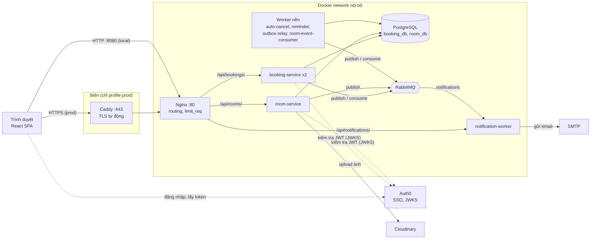
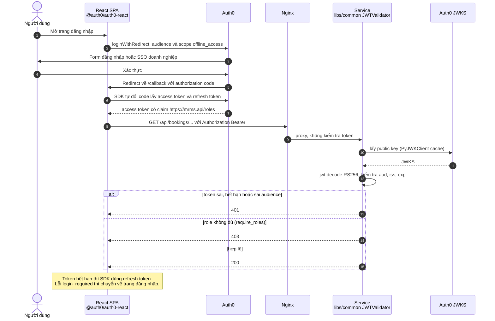
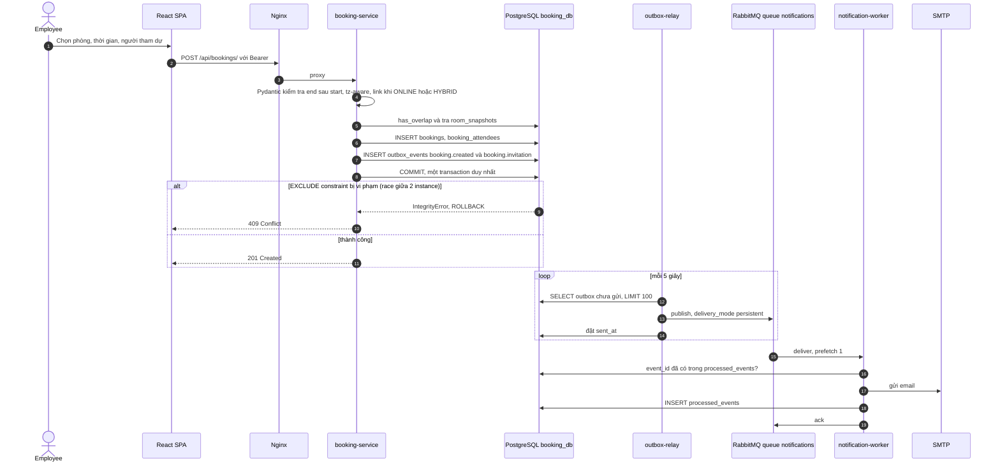
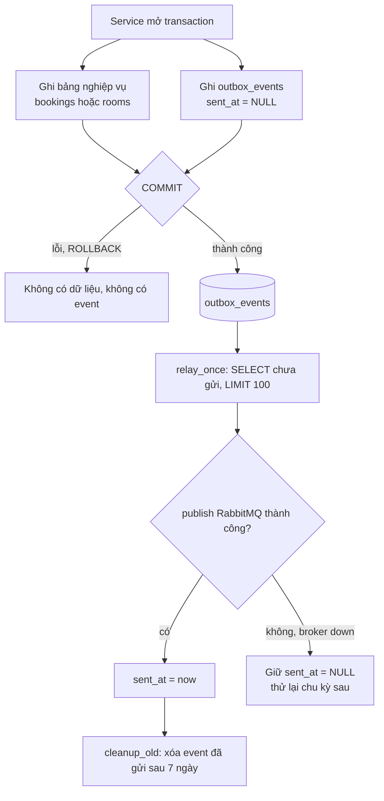
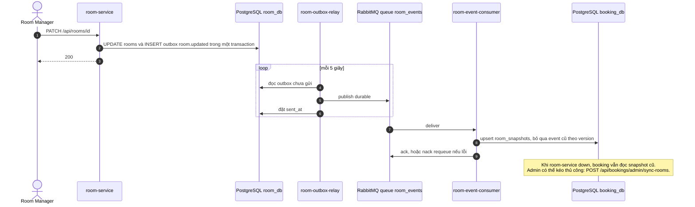
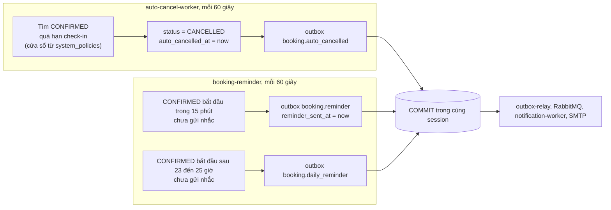
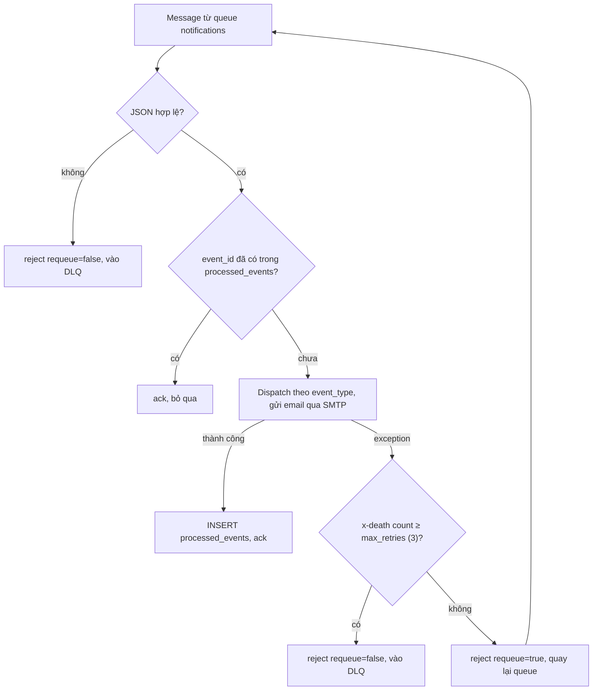
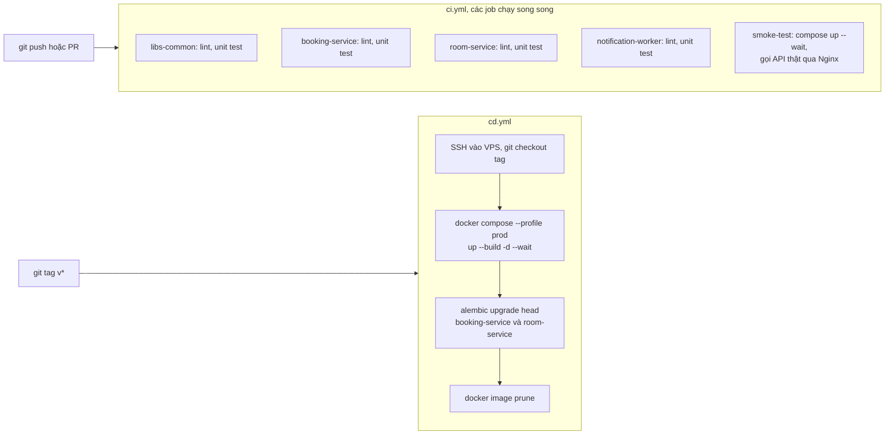

# Báo cáo công nghệ — Meeting Room Management System

> Cập nhật lần cuối: 2026-11-25

Tài liệu này giải thích các công nghệ đang dùng trong dự án, lý do chọn, và quy trình (workflow) từ lúc code đến lúc chạy production-like. Đọc kèm `CLAUDE.md` để biết quyết định kiến trúc (ADR) chi tiết.

## 1. Tổng quan stack

| Lớp | Công nghệ | Vai trò |
|---|---|---|
| Backend framework | FastAPI (Python 3.12) | Viết REST API cho booking-service và room-service |
| ORM | SQLAlchemy 2.x (sync) | Map Python object ↔ bảng Postgres |
| Migration | Alembic | Quản lý thay đổi schema theo version, không sửa DB bằng tay |
| Validation | Pydantic v2 | Validate request/response body, tương đương Bean Validation bên Java |
| Database | PostgreSQL | Lưu dữ liệu, mỗi service có DB và user riêng |
| Message broker | RabbitMQ | Truyền event giữa các service và worker, không đồng bộ |
| Object storage | Cloudinary | Lưu ảnh phòng họp |
| Auth | Auth0 (JWT) | Đăng nhập và cấp token, không tự quản lý mật khẩu |
| Gateway | Nginx | Cổng duy nhất public ra ngoài, route request, rate limit |
| Container | Docker + Docker Compose | Đóng gói và chạy toàn bộ hệ thống nhiều service |
| CI | GitHub Actions | Tự động lint, test, smoke test mỗi lần push |
| Frontend | React 19 + TypeScript + Vite | Giao diện web |
| UI library | Ant Design 6 | Component có sẵn, tiết kiệm thời gian build UI |
| Frontend test | Vitest | Unit test cho React components và API layer |

## 2. Vì sao chọn các công nghệ này

### FastAPI thay vì Spring Boot

Yêu cầu dự án là Python. FastAPI đóng vai trò giống `@RestController` của Spring: khai báo route bằng decorator, inject dependency qua `Depends()` (tương đương `@Autowired`), tự sinh Swagger UI. Khác biệt chính: FastAPI không có DI container lớn như Spring, nên code phải tự quản lý lifecycle của service/repository qua factory function.

### SQLAlchemy sync, không async

Đã quyết định dùng sync để đơn giản hóa debug và tránh async/await lan ra toàn bộ codebase khi chưa cần thiết. Nhược điểm: throughput thấp hơn async dưới tải cao. Dự án chấp nhận đánh đổi này vì quy mô demo nhỏ, số lượng concurrent request không lớn. Sẽ xem lại nếu có bằng chứng nghẽn.

### Kiến trúc microservices với database-per-service

Mỗi service (booking-service, room-service) có PostgreSQL database và user riêng, không JOIN chéo, không chia sẻ foreign key. Lý do: nếu một service đổi schema, service khác không bị vỡ. Cái giá phải trả là cần cơ chế đồng bộ dữ liệu giữa các service (xem mục 4).

### RabbitMQ cho giao tiếp bất đồng bộ

Dùng cho hai việc: (1) gửi thông báo email không chặn request chính, (2) đồng bộ dữ liệu phòng từ room-service sang booking-service qua event. Chọn một broker dùng cho cả hai việc để giảm số công nghệ phải học và vận hành.

### Nginx làm API Gateway, không viết gateway riêng

Thay vì viết một service gateway bằng code, dùng Nginx có sẵn để route và rate limit. Đánh đổi: mỗi service phải tự xác thực JWT (không có chỗ tập trung), nhưng đổi lại không phải vận hành thêm một service.

### Auth0 thay vì tự xây auth

Tự viết hệ thống đăng nhập, quản lý mật khẩu, refresh token là rủi ro bảo mật cao cho một dự án 8 tuần. Auth0 lo phần đó, backend chỉ cần validate JWT bằng public key (thư viện `PyJWT`).

### React + Vite + Ant Design

Vite build nhanh hơn Create React App (dùng esbuild/rollup, hot reload tức thời). Ant Design cho sẵn component Table, Form, Modal... đúng kiểu ứng dụng quản trị nội bộ, không cần tự thiết kế design system từ đầu.

## 3. Workflow — từ code đến chạy

### 3.1 Git workflow

```
main (luôn chạy được, bảo vệ không cho push thẳng)
  ├── feat/xxx   (tính năng mới)
  ├── fix/xxx    (sửa lỗi)
  ├── docs/xxx   (tài liệu)
  └── chore/xxx  (việc vặt: cấu hình, dependency...)
```

- Không có nhánh `develop`. Đây là **GitHub Flow**: một nhánh ngắn hạn cho một việc, mở Pull Request, CI chạy xanh thì **squash merge** vào `main`, xóa nhánh.
- Commit message theo **Conventional Commits**: `feat(booking): ...`, `fix(room-service): ...`, `docs: ...`. Giúp đọc lịch sử git và tự động sinh changelog sau này nếu cần.
- Nhánh sống ngắn (≤ 3 ngày) để tránh conflict lớn khi merge.

### 3.2 Vòng lặp phát triển local

```
1. Sửa code
2. pre-commit chạy tự động khi git commit:
   - ruff check --fix   (lint, tự sửa lỗi đơn giản)
   - ruff format        (format code)
   - check-yaml, trailing-whitespace, detect-private-key...
3. make test            (unit test, không cần DB)
4. make test-integration (cần Postgres chạy qua Docker)
5. docker compose up --build -d --wait
6. Kiểm tra thủ công qua Swagger hoặc curl
```

Pre-commit hook chặn commit nếu lint/format fail, nên lỗi style không bao giờ vào git history.

### 3.3 CI pipeline (GitHub Actions, `.github/workflows/ci.yml`)

Chạy song song 5 job mỗi lần push:

| Job | Làm gì |
|---|---|
| `libs-common` | Lint + test package dùng chung (logging, config, auth) |
| `booking-service` | Cài `libs/common`, lint, unit test |
| `room-service` | Cài `libs/common`, lint, unit test |
| `notification-worker` | Lint, unit test |
| `smoke-test` | Build toàn bộ bằng Docker Compose, gọi API thật qua Nginx để chắc chắn hệ thống khởi động được, không chỉ test đơn lẻ pass |

`smoke-test` là lớp bảo vệ cuối: unit test có thể pass hết nhưng Docker Compose vẫn fail (sai biến môi trường, sai network...). Job này bắt được loại lỗi đó.

### 3.4 Database migration workflow

```
1. Sửa model (app/models/*.py)
2. alembic revision --autogenerate -m "mô tả"
3. Đọc lại file migration sinh ra, sửa tay nếu cần (đặc biệt constraint, index)
4. alembic upgrade head   (áp dụng vào DB local)
5. Viết integration test xác nhận schema đúng
6. Commit cả model lẫn file migration trong cùng 1 PR
```

Không bao giờ sửa schema bằng tay qua `psql`. Mọi thay đổi đi qua migration để mọi môi trường (local, CI, demo) đồng bộ.

### 3.5 Docker Compose — chạy toàn hệ thống

12 service trong `docker-compose.yml`, chia 3 nhóm:

- **Hạ tầng:** `postgres`, `rabbitmq`, `nginx`
- **API service:** `booking-service`, `room-service`
- **Worker nền** (mỗi cái 1 container riêng, cùng image với service chủ nhưng chạy command khác):
  `auto-cancel-worker`, `outbox-relay`, `booking-reminder`, `room-outbox-relay`, `room-event-consumer`, `notification-worker`

Chỉ Nginx mở port ra host (`8080`). Service và Postgres chỉ gọi được trong Docker network nội bộ, nên không ai truy cập thẳng vào database hay service từ ngoài.

### 3.6 Transactional outbox + event-driven sync (workflow riêng, hay nhầm)

Đây là workflow đặc thù của dự án, đáng giải thích riêng vì dễ hiểu sai:

```
Request sửa phòng (PATCH /api/rooms/{id})
        │
        ▼
Service ghi 2 thứ trong CÙNG 1 transaction:
  - UPDATE rooms SET ...
  - INSERT INTO outbox_events (event_type="room.updated", payload=...)
        │
        ▼ (transaction commit — cả 2 cùng thành công hoặc cùng rollback)
        │
room-outbox-relay (worker riêng, poll mỗi 5 giây)
  đọc outbox_events chưa gửi → publish lên RabbitMQ
        │
        ▼
room-event-consumer (worker bên booking-service)
  nhận event → upsert vào bảng room_snapshots (booking_db)
```

**Vì sao không update DB rồi gọi RabbitMQ publish trực tiếp?** Nếu publish thất bại giữa chừng (mất mạng, broker down), DB đã update nhưng event không bao giờ gửi → hai service lệch dữ liệu vĩnh viễn. Outbox pattern đảm bảo: event chỉ "mất" nếu transaction DB cũng rollback, không có nửa chừng.

**Hệ quả cần nhớ:** nếu một thao tác ghi thẳng vào bảng `rooms` mà không qua service layer (ví dụ script seed dữ liệu chạy SQL trực tiếp), outbox_events sẽ không có event nào được tạo, booking-service sẽ không bao giờ biết phòng đó tồn tại. Đây là lỗi đã gặp thực tế khi seed demo data — ghi nhận lại để tránh lặp lại.

## 4. Điểm cần người review hiểu rõ (dễ hỏi khi demo)

1. **Tại sao 2 database riêng mà vẫn JOIN được phòng với lịch đặt?** Nhờ `room_snapshots` — bản sao cục bộ trong `booking_db`, đồng bộ qua event, không phải JOIN chéo thật.
2. **Nếu room-service chết, booking-service có chết theo không?** Không. Booking vẫn đọc được `room_snapshots` cũ, chỉ là dữ liệu có thể hơi cũ (eventual consistency), không phải lúc nào cũng mới nhất.
3. **Double booking được chặn ở đâu?** Ở tầng PostgreSQL bằng `EXCLUDE CONSTRAINT`, không chỉ ở code Python — vì booking-service chạy nhiều instance, lock trong process không đủ.
4. **Vì sao cần outbox thay vì gọi RabbitMQ publish trực tiếp trong code?** Xem mục 3.6 — đảm bảo không lệch dữ liệu khi publish thất bại giữa chừng.

## 5. Chưa làm / còn thiếu công nghệ

- Chưa có observability tập trung (metrics, tracing) — hiện chỉ có JSON log với `request_id`.
- Chưa có CD (Continuous Deployment) tự động, CI dừng ở build + test.
- FR-07 (báo cáo) và FR-08 (audit log) chưa có code backend — xem `docs/progress.md`.

## 6. Luồng hoạt động của các công nghệ

Các sơ đồ vẽ theo code hiện tại (Mermaid, render trực tiếp trên GitHub). Mỗi sơ đồ kèm ghi chú về lý do thiết kế hoặc rủi ro cần biết.

### 6.1 Kiến trúc tổng thể



Ghi chú: Nginx là điểm vào duy nhất, chỉ Nginx mở port ra host. Nginx không kiểm tra token; mỗi service tự xác thực (ADR-0001). Ở prod, Caddy đứng trước Nginx, xem mục 6.9 về hệ quả với rate limit.

### 6.2 Đăng nhập và xác thực JWT (Auth0 + RBAC)



Ghi chú: Administrator luôn được bypass trong `require_roles`. Frontend chỉ dùng role để ẩn hoặc hiện UI (`roleMapper.ts`); quyết định cuối cùng luôn ở backend.

### 6.3 Đặt phòng: transaction đồng bộ và thông báo bất đồng bộ



Ghi chú: email được gửi sau khi request đã trả 201, nên request đặt phòng không bị chậm bởi SMTP. Chống double booking nằm ở DB (EXCLUDE constraint), không phải ở lock trong process.

### 6.4 Transactional outbox



Ghi chú: nếu publish trực tiếp trong request và broker down sau khi DB đã commit thì hai service lệch dữ liệu vĩnh viễn. Outbox đảm bảo event và dữ liệu nghiệp vụ cùng sống hoặc cùng chết. Lưu ý: ghi thẳng vào `rooms` bằng SQL (không qua service) sẽ không tạo event.

### 6.5 Đồng bộ dữ liệu phòng sang booking-service (ADR-0003)



### 6.6 Worker nền: tự hủy khi không check-in và nhắc lịch



Ghi chú: mỗi worker là một process riêng cùng image với booking-service, chạy bằng `python -m app.workers.<tên>`. Cả hai đều ghi outbox trong cùng transaction với cập nhật trạng thái, nên không có trường hợp booking bị hủy mà email không được gửi.

### 6.7 Xử lý thông báo: idempotency, retry và DLQ



**Cảnh báo (cần kiểm chứng bằng test):** nhánh `requeue=true` không tạo entry `x-death` trong RabbitMQ, vì message chỉ được ghi `x-death` khi bị dead-letter. Do đó `_get_retry_count` luôn trả 0 với message lỗi do exception, và message lỗi có thể lặp vô hạn. Chi tiết ở mục 6.9.

### 6.8 CI/CD



### 6.9 Các điểm phát hiện khi vẽ sơ đồ

| # | Vấn đề | Vị trí | Ảnh hưởng | Hướng xử lý |
|---|---|---|---|---|
| 1 | Retry đếm qua `x-death` nhưng nhánh requeue không tạo `x-death` | `services/notification-worker/app/worker.py` (`_get_retry_count`, nhánh `reject(requeue=True)`) | Message lỗi có thể lặp vô hạn, không bao giờ vào DLQ. Cần xác nhận bằng test thật | Dùng retry queue có TTL và dead-letter về queue chính, hoặc tự đếm số lần retry trong header |
| 2 | Rate limit theo `$binary_remote_addr`, không có `set_real_ip_from` | `infra/nginx/nginx.conf:26` | Ở prod Caddy đứng trước Nginx, mọi client có cùng IP nguồn, nên 20 req/s thành giới hạn dùng chung cho cả hệ thống | Khai báo `set_real_ip_from` cho IP của Caddy và `real_ip_header X-Forwarded-For` |
| 3 | Integration test không chạy trong CI | `pyproject.toml` có `addopts = -m 'not integration'`, `ci.yml` chỉ chạy `pytest` | Lỗi DB, EXCLUDE constraint và concurrency không được bắt tự động | Thêm job chạy `make test-integration` có Postgres service |
| 4 | Idempotency ghi sau khi gửi email | `worker.py`, `ProcessedEvent` được INSERT sau `handler(payload)` | Nếu worker crash giữa lúc gửi và lúc ghi, email có thể gửi lại (at-least-once) | Chấp nhận ở MVP, ghi rõ trong phần hạn chế của báo cáo |
